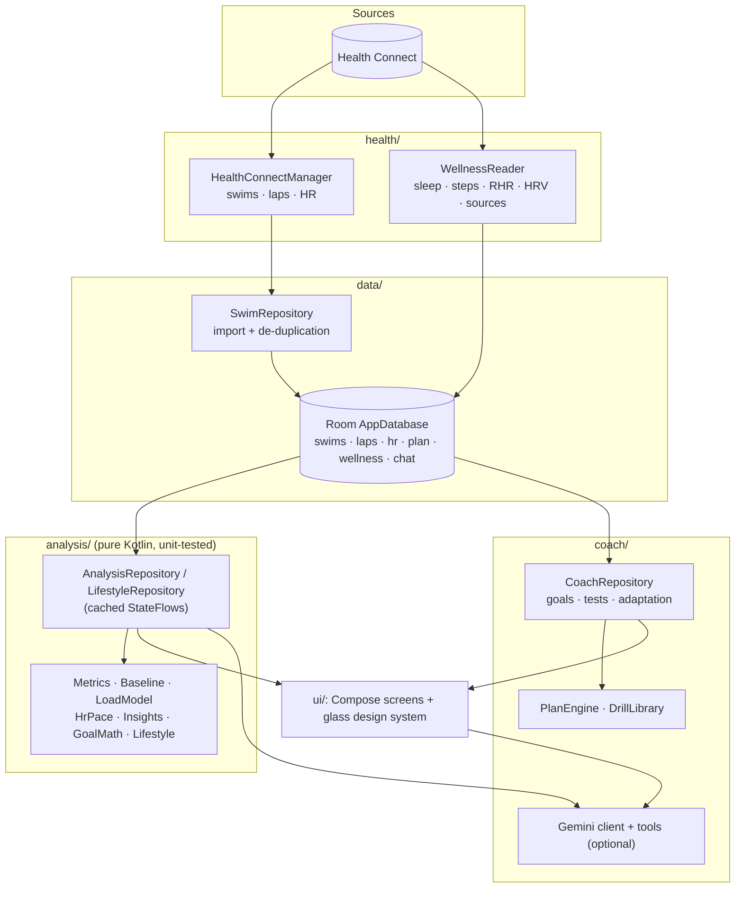

# Contributing to Hamuk Swims

Thanks for wanting to help! This guide gets you from clone to pull request.

- [Ground rules](#ground-rules)
- [Set up](#set-up)
- [Architecture](#architecture)
- [Everyday workflow](#everyday-workflow)
- [Recipes](#recipes)
- [Pull request checklist](#pull-request-checklist)
- [Good first issues](#good-first-issues)

## Ground rules

1. **Privacy first.** No analytics, trackers, accounts or new network calls without discussion. Health data never leaves the device except the user-initiated Gemini chat.
2. **Offline first.** Coaching features must work with no internet and no AI. Gemini is an optional layer on top of deterministic code.
3. **Explainable numbers.** Every metric lives in pure, unit-tested Kotlin under `analysis/` and is documented in [docs/METRICS.md](docs/METRICS.md).
4. **Never lose user data.** Database changes ship with a Room `Migration`; no destructive migrations.
5. **No secrets in git.** No keystores, `local.properties`, API keys or real health data (use `SampleData` for screenshots).

## Set up

**You need:** JDK 17, Android SDK platform 36 (and build-tools), and optionally Android Studio (latest stable) or any editor plus the command line.

```bash
git clone https://github.com/tharunjagadeesh/hamuk-swims.git
cd hamuk-swims
echo "sdk.dir=/path/to/android-sdk" > local.properties   # Android Studio does this for you
export JAVA_HOME=/path/to/jdk-17

./gradlew testDebugUnitTest      # all unit tests
./gradlew assembleDebug          # debug APK
adb install -r app/build/outputs/apk/debug/app-debug.apk
```

**Test data without a watch:**
- Use an emulator image with Google APIs, API 34+, which has Health Connect built in.
- In the **debug** build open **Settings → Data inspector → Load sample swims** for 10 weeks of synthetic swims (lengths, strokes, HR) and daily sleep, steps and HRV. **Clear** removes it.

**Release builds** need your own signing key: create `keystore.properties` (git-ignored) with `storeFile`, `storePassword`, `keyAlias`, `keyPassword`, then run `./gradlew assembleRelease`.

## Architecture



| Package | Responsibility | Rules |
|---|---|---|
| `health/` | Talk to Health Connect | Read-only. Ask for new permissions in `HealthConnectManager.allPermissions` and the manifest. |
| `data/` | Room entities and DAOs, repositories, settings, encrypted key store | Bump the DB version and add a `Migration` for every schema change. |
| `analysis/` | All derived numbers | **No Android imports** apart from data classes, so everything is JVM-testable. Return `null` when data is missing. |
| `coach/` | Plan generation and adaptation, Gemini | `PlanEngine` is pure and deterministic; Gemini can only *propose* changes through `CoachTools`. |
| `ui/` | Screens | Use the design system in `Glass.kt` / `Charts.kt` / `AnalysisCharts.kt` (`GlassCard`, `MetricTile`, `DeltaRow`, `MultiLineChart`, `ScatterChart`…) instead of raw Material surfaces. |

**State:** repositories expose `Flow`/`StateFlow`; screens collect with `collectAsState()`. `AppContainer` (in `SwimProApp.kt`) is the manual dependency container: no DI framework.

## Everyday workflow

1. Open or claim an issue first for anything non-trivial.
2. Branch from `main`: `feat/<short-name>`, `fix/<short-name>` or `docs/<short-name>`.
3. Keep commits focused; write messages in the imperative ("Add fade metric to compare table").
4. Run `./gradlew testDebugUnitTest assembleDebug` before pushing.
5. Open a PR using the checklist below, with screenshots for UI changes (dark **and** light, sample data only).

**Code style:**
- Kotlin official style (`kotlin.code.style=official`).
- Match surrounding code: small functions, KDoc on public functions in `analysis/` explaining the *why* and formula, no magic numbers without a comment.

## Recipes

### Add a new swim metric
1. Compute it in `SwimMetrics.from()` (`analysis/Metrics.kt`) as a nullable field.
2. Add it to the `Metric` enum in `analysis/Baseline.kt`. This gives you comparisons, baselines, the explorer and week/day aggregation for free. Set `higherIsBetter` and `agg`.
3. Show it in `ui/AnalysisCards.kt` if it deserves a tile.
4. Add a hand-calculated unit test in `app/src/test/.../analysis/AnalysisTest.kt`.
5. Document the formula in `docs/METRICS.md`.

### Add a lifestyle factor
1. Read it in `health/WellnessReader.read()`, then add a column to `DailyWellness` with a migration.
2. Map it in `Lifestyle.context()` and add a `Factor` entry.
3. Add a test in `LifestyleTest.kt`.

### Add a screen
1. Create a composable in `ui/`, wrap content in `Page { DetailHeader(...) ... }` and use `appear(index)` for the entrance animation.
2. Register a route in `ui/Root.kt` (`AppNavHost`).

### Change the database
1. Edit the entity and DAO.
2. Bump `version` in `@Database`.
3. Add `MIGRATION_n_(n+1)` in `Database.kt` and register it in `build()`.
4. Test the upgrade: install the previous release, add data, then install yours over it.

## Pull request checklist

- [ ] `./gradlew testDebugUnitTest` passes; new logic has tests
- [ ] No new network calls, trackers or permissions (or they're justified in the PR)
- [ ] No secrets, personal paths or real health data in the diff
- [ ] DB changes include a migration and were tested as an upgrade
- [ ] UI changes include dark and light screenshots using sample data
- [ ] `docs/` updated if behaviour or metrics changed

## Good first issues

- Yards support for pools measured in yards.
- Cold-start guard for the ACWR gauge: hide the verdict until 4 weeks of history.
- Light-mode polish pass over the analysis charts.
- JSON **import** to match the existing export.
- More drills in `coach/DrillLibrary.kt` (with clear coaching cues).
- Accessibility: content descriptions on chart canvases, larger touch targets on RPE dots.

## Questions

Open a GitHub Discussion or issue. Security issues: see [SECURITY.md](SECURITY.md) and **don't** file them publicly.
