<p align="center">
  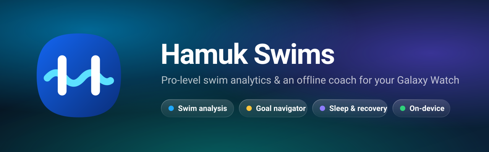
</p>

<p align="center">
  
  
  
  
  
</p>

**Hamuk Swims** turns the swims your Galaxy Watch records into Garmin/TrainingPeaks-style analysis, a training plan that adapts to you, and a coach that works **without the internet**. It reads data from **Health Connect**, so Samsung Health, Google Fit, Fitbit or Pixel Watch all work, and it keeps everything on your phone.

<p align="center">
  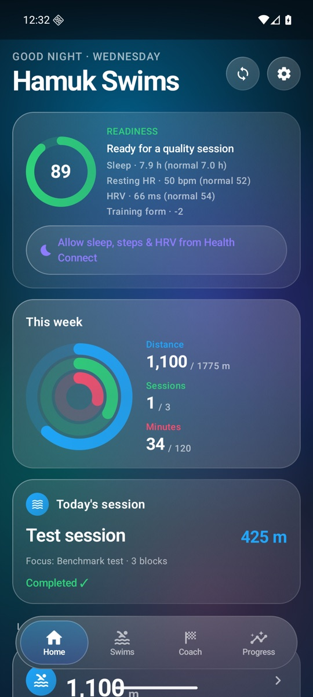
  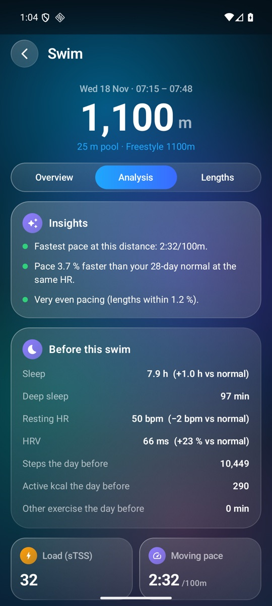
  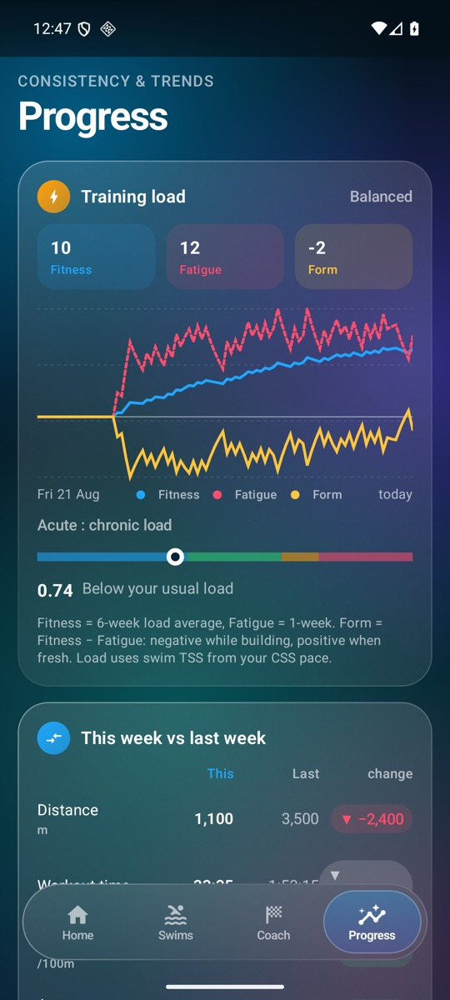
  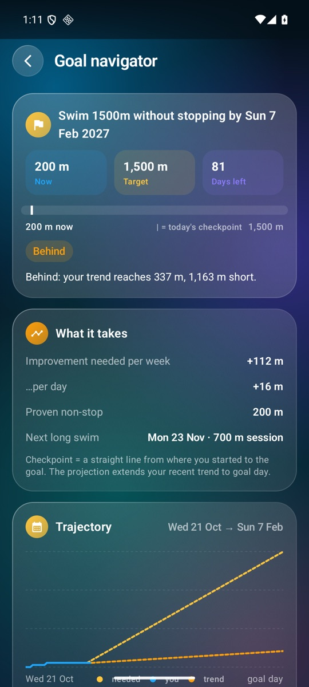
</p>

---

## ✨ Features

| | |
|---|---|
| 🏊 **Automatic swim log** | Every pool or open-water swim from your watch: distance, moving time, pace per length, heart rate, strokes, SWOLF, calories. |
| 📊 **Pro metrics per swim** | Training load (sTSS, TRIMP), efficiency, aerobic drift, HR zones, split, fade, pace variation, stroke rate, distance per stroke. |
| ↔️ **Comparisons** | Each swim vs your previous swim, previous swim day and 28-day normal range; side-by-side compare of any two swims, days or weeks. |
| ❤️ **Heart rate vs pace** | Per-length scatter plus your "pace at your usual heart rate", a clean aerobic-fitness trend. |
| 📈 **Fitness · Fatigue · Form** | 42/7-day training-load model with an acute:chronic load gauge to flag risky spikes. |
| 🧭 **Goal navigator** | Where you are vs your goal, what's needed per week and day, trend projection, and exact target paces for the next 7 days. Fully offline. |
| 😴 **What affects your swimming** | Correlates sleep, steps, calories, other workouts, resting HR and HRV with how fast and how efficiently you swim. |
| 🔋 **Readiness** | Daily 0–100 score from sleep, resting HR, HRV and training form. On low days the plan switches to easy work. |
| 🗓️ **Adaptive plan** | CSS-based zones, base → build → taper, recovery weeks; adapts when you miss sessions, feel wrecked or get faster. |
| 🤖 **Optional AI coach** | Chat with Google Gemini using your own key; it sees all the analysis and can propose plan changes you approve. |
| 💎 **Glass UI** | Samsung Health-style metric tiles on Apple-style frosted glass, with fluid animations and light & dark themes. |

---

## 🧩 How it works

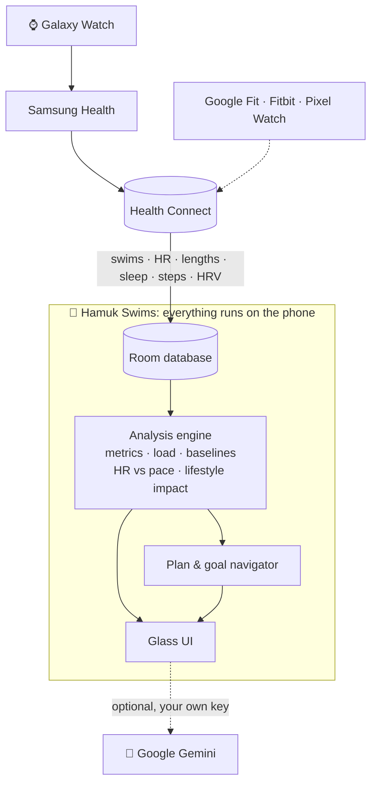

- **Single source of truth:** Health Connect. If two apps record the same swim, the one with more detail (lengths, HR) is kept.
- **Deterministic first:** every number, insight and target is calculated by tested Kotlin code (`analysis/`), not by an LLM.
- **AI is optional:** Gemini only sees a text summary, and only when you use the chat.

---

## 📱 Walkthrough

### 1. Home: your day at a glance
<table><tr>
<td width="50%"></td>
<td>

- **Readiness ring:** last night's sleep, resting HR and HRV vs your normal, plus training form.
- **This week rings:** distance, sessions and minutes vs plan.
- **Today's session** from your plan.
- **Goal navigator** summary and **Since your last swim** deltas (scroll down).

</td></tr></table>

<table><tr>
<td width="50%">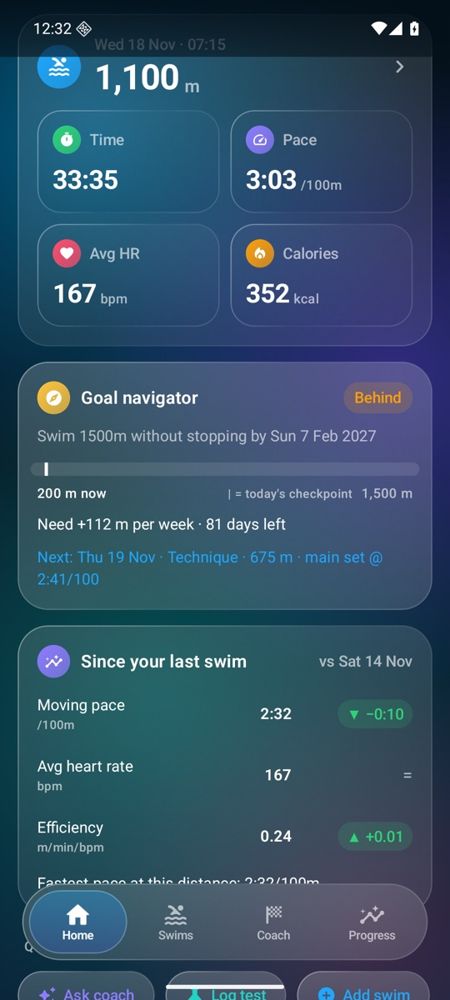</td>
<td>

The **Goal navigator** card says whether you're on track and what your next swim's main-set pace should be. **Since your last swim** shows the biggest changes, coloured green or red by whether they're improvements.

</td></tr></table>

### 2. Swims and the per-swim analysis
<table><tr>
<td width="33%">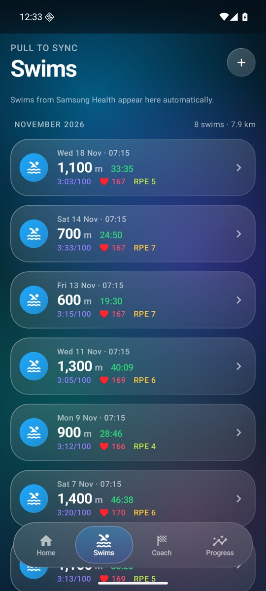</td>
<td width="33%">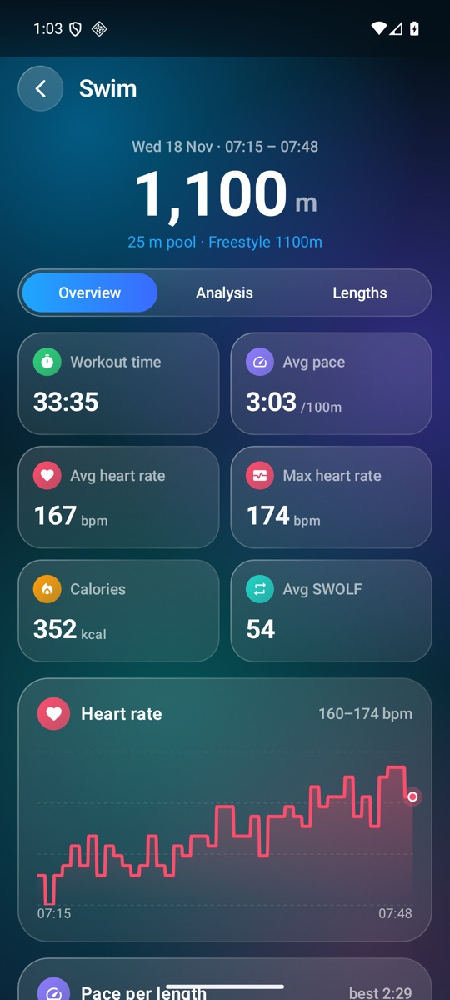</td>
<td width="33%"></td>
</tr><tr>
<td>Every swim, grouped by month. Pull down to sync.</td>
<td><b>Overview</b>: tiles, HR chart, pace per length, and your effort (RPE) and notes.</td>
<td><b>Analysis</b>: plain-English insights, plus your sleep and activity before the swim.</td>
</tr></table>

<table><tr>
<td width="33%">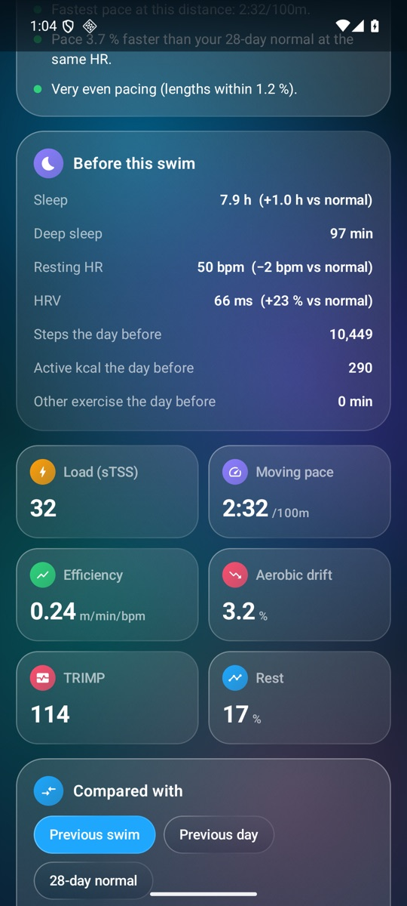</td>
<td width="33%">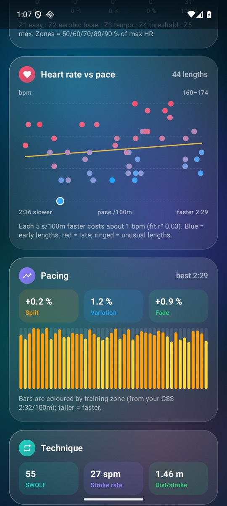</td>
<td width="33%">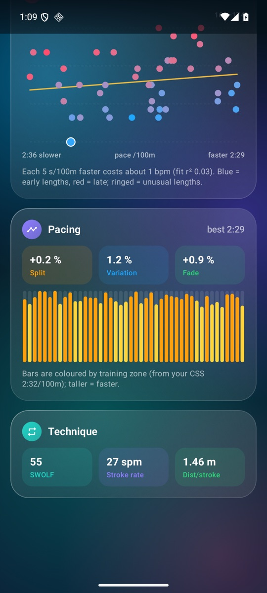</td>
</tr><tr>
<td>Compare with your <b>previous swim</b>, <b>previous day</b> or <b>28-day normal</b> (with range bars).</td>
<td>Heart rate vs pace for every length: blue = early, red = late. Shows drift and unusual lengths.</td>
<td>Split, variation and fade; per-length bars coloured by training zone; SWOLF and stroke rate.</td>
</tr></table>

### 3. Compare anything
<table><tr>
<td width="50%">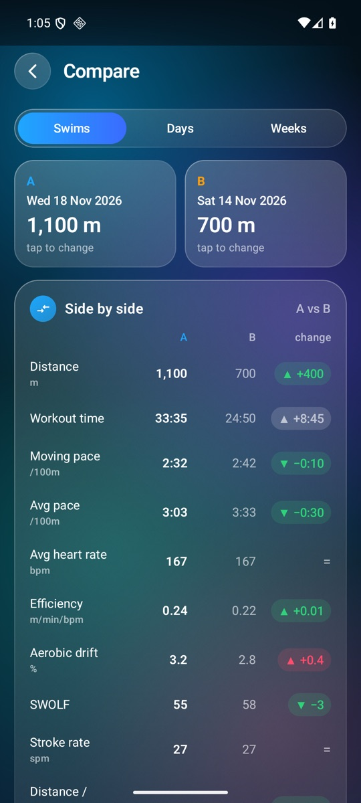</td>
<td width="50%">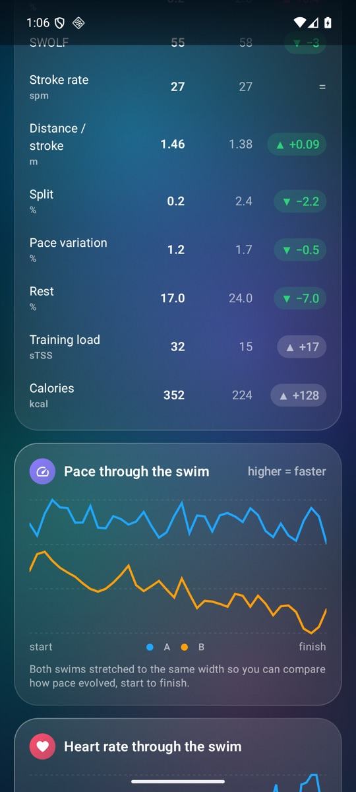</td>
</tr></table>

Pick **Swims**, **Days** or **Weeks**, choose A and B, and get a full metric table plus overlaid pace and heart-rate curves.

### 4. Progress: are you getting fitter?
<table><tr>
<td width="33%"></td>
<td width="33%">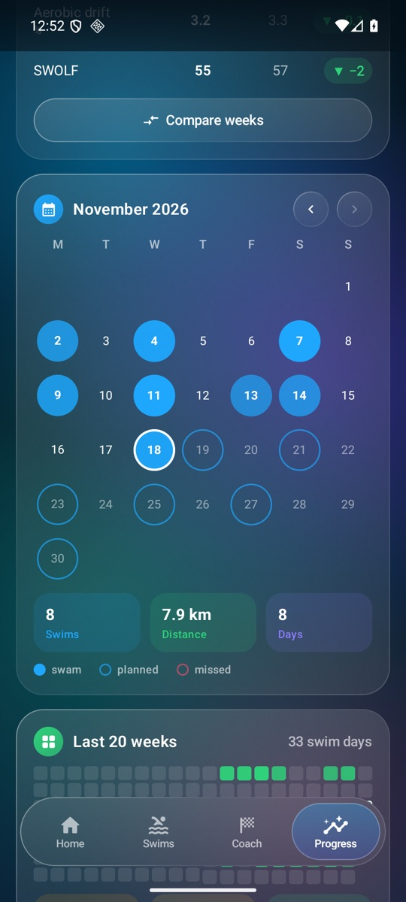</td>
<td width="33%">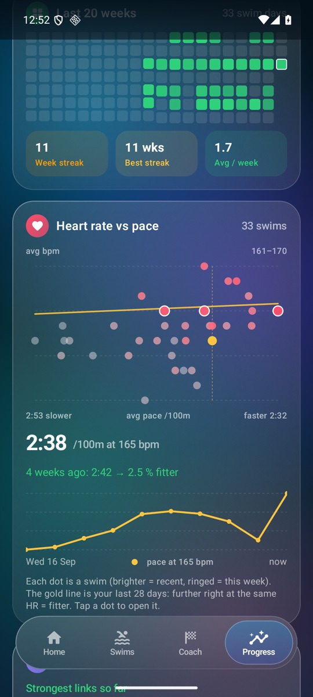</td>
</tr><tr>
<td><b>Fitness · Fatigue · Form</b> and the acute:chronic load gauge.</td>
<td><b>Consistency calendar</b> and a 20-week heatmap with streaks.</td>
<td><b>Pace at your usual HR</b>: further right at the same HR = fitter.</td>
</tr></table>

<table><tr>
<td width="50%">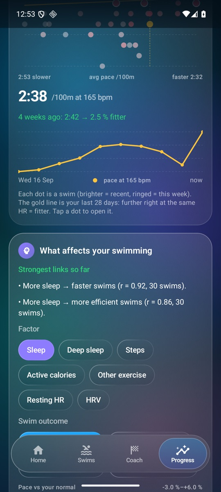</td>
<td>

**What affects your swimming** pairs each swim with the night's sleep, the previous day's steps, calories and workouts, and morning resting HR and HRV. It then measures the link to your pace, efficiency, heart-rate cost and RPE. Findings only appear with real evidence (8+ swims, |r| ≥ 0.3); until then it says it's collecting data.

*(Screenshot uses synthetic sample data with a built-in sleep → pace link.)*

</td></tr></table>

### 5. Coach & goal navigator
<table><tr>
<td width="33%">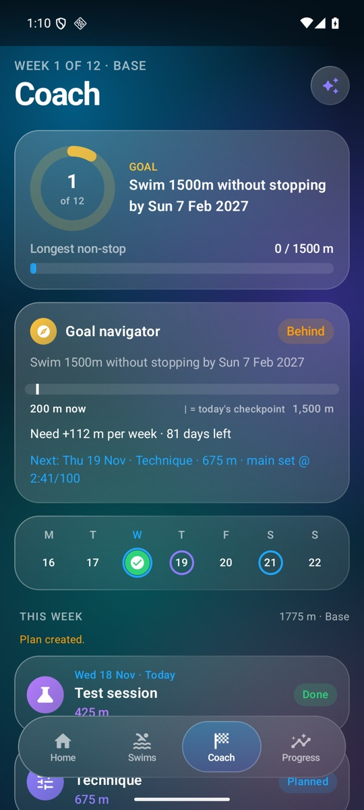</td>
<td width="33%"></td>
<td width="33%">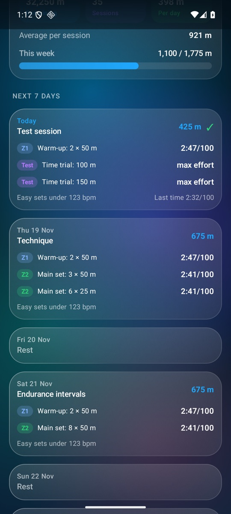</td>
</tr><tr>
<td>Your goal, the week strip, planned sessions, pace zones and the optional AI chat.</td>
<td>Gap to goal, improvement needed per week and day, projection and trajectory.</td>
<td>Next 7 days with exact target paces per set and an HR ceiling for easy work.</td>
</tr></table>

➡️ The full step-by-step is in the **[User guide](docs/USER_GUIDE.md)**.

---

## 📏 Metrics in one line each

| Metric | Meaning |
|---|---|
| **CSS** | Critical Swim Speed: your threshold pace per 100 m; all zones derive from it. |
| **Moving pace** | Pace while actually swimming (wall rests removed). |
| **sTSS** | Swim training stress: intensity³ × hours × 100, relative to CSS. |
| **TRIMP** | Heart-rate-based training impulse (Banister). |
| **RPE** | How hard it felt, 1–10, entered by you. |
| **Efficiency (EF)** | Metres per minute ÷ average heart rate. Higher = fitter. |
| **Aerobic drift** | How much HR rose against pace in the second half (< 5 % is solid). |
| **Fitness / Fatigue / Form** | 42-day and 7-day load averages, and their difference. |
| **ACWR** | 7-day ÷ 28-day load; 0.8–1.3 is the sweet spot. |

Formulas and caveats are in **[docs/METRICS.md](docs/METRICS.md)**.

---

## 🔒 Privacy & security

- **No account, no server, no analytics.** All data stays in the app's private storage on your phone.
- Reads Health Connect **read-only**. It never writes or deletes your health data.
- The optional Gemini key is stored **encrypted with the Android Keystore**, and the app shows usage and quota alerts.
- No secrets in this repo: signing keys, local paths and build output are git-ignored.

See **[SECURITY.md](SECURITY.md)** for details and how to report an issue.

---

## 🚀 Install

**Option A: sideload an APK** (when one is published under *Releases*): download it on your phone, allow "Install unknown apps" for your browser or files app, and open the APK.

**Option B: build from source**

```bash
# Requirements: JDK 17 and the Android SDK (platform 36). Point Gradle at them:
export JAVA_HOME=/path/to/jdk-17
echo "sdk.dir=/path/to/android-sdk" > local.properties

./gradlew testDebugUnitTest   # run the test suite
./gradlew assembleDebug       # app/build/outputs/apk/debug/app-debug.apk
```

Then install with `adb install app/build/outputs/apk/debug/app-debug.apk`. Debug builds include **Settings → Data inspector → Load sample swims**, which generates 10 weeks of synthetic data to explore every screen.

---

## 🗂️ Project layout

| Path | What lives there |
|---|---|
| `app/src/main/java/.../health/` | Health Connect reading: swims, laps, HR, sleep, steps, HRV, data sources |
| `.../data/` | Room database, repositories, settings, encrypted key store, sample-data generator |
| `.../analysis/` | **Pure, unit-tested engine**: metrics, baselines, load model, HR vs pace, insights, goal maths, lifestyle impact |
| `.../coach/` | Plan engine (CSS zones, periodisation, drills), Gemini client, usage tracking |
| `.../ui/` | Jetpack Compose screens, glass design system, charts |
| `.../update/` | Optional over-the-air updater (GitHub Releases) |
| `app/src/test/` | Unit tests (`./gradlew testDebugUnitTest`) |

---

## 🤝 Contributing

Ideas, bug reports and pull requests are welcome. Start with **[CONTRIBUTING.md](CONTRIBUTING.md)**: it covers setup, architecture, conventions and good first issues.

## ⚠️ Disclaimer

Hamuk Swims is a personal training tool, not a medical device. Stop and seek medical advice if you feel chest pain, dizziness or unusual breathlessness.

## License

No license has been chosen yet, so all rights are reserved by the author. You're welcome to read the code and open issues or PRs; please ask before reusing it elsewhere.
