# Hamuk Swims: user guide

This guide walks you through setting up the app and getting the most out of it. Screenshots use synthetic sample data.

- [1. What you need](#1-what-you-need)
- [2. Install](#2-install)
- [3. First-time setup](#3-first-time-setup)
- [4. Recording swims](#4-recording-swims)
- [5. Daily use](#5-daily-use)
- [6. Reading a swim](#6-reading-a-swim)
- [7. Goals, plans and the goal navigator](#7-goals-plans-and-the-goal-navigator)
- [8. Tests: keeping your paces accurate](#8-tests-keeping-your-paces-accurate)
- [9. Progress and "what affects your swimming"](#9-progress-and-what-affects-your-swimming)
- [10. The optional AI coach](#10-the-optional-ai-coach)
- [11. Settings, data and privacy](#11-settings-data-and-privacy)
- [12. Troubleshooting](#12-troubleshooting)

---

## 1. What you need

- An Android phone running **Android 9 or newer** with **Health Connect** (built into Android 14+; installable from the Play Store on older versions).
- A watch or app that records swims into Health Connect. The app is designed around **Galaxy Watch + Samsung Health**. Google Fit, Fitbit, Pixel Watch and other Health Connect apps work too.
- Optional: a free **Google Gemini API key** for the chat coach.

## 2. Install

1. Download the APK on your phone (or copy it over).
2. Open it. Android asks to allow installs from that source: allow it for your browser or files app.
3. Tap **Install**. Later versions install over the top and keep your data.

> Building it yourself? See the README's *Install → build from source*.

## 3. First-time setup

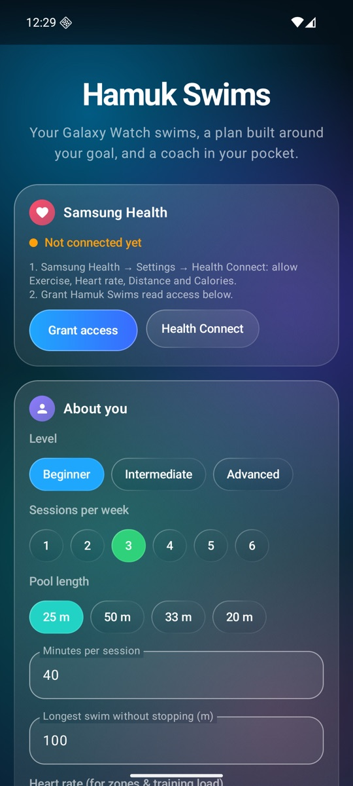

1. **Let Samsung Health share with Health Connect.** In Samsung Health: *Settings → Health Connect* → allow **Exercise, Heart rate, Distance, Calories**. For the readiness and lifestyle features, also allow **Sleep, Steps, Resting heart rate, HRV**.
2. In Hamuk Swims tap **Grant access** and allow everything you're comfortable with. Turn on **Access past data** so older swims are imported. Without it, Android only shares the last 30 days.
3. Fill in **About you**: level, sessions per week, pool length, minutes per session and the longest distance you can swim without stopping. Tap **Let's swim**.

The app imports your swims straight away and syncs again whenever you open it, plus every ~6 hours in the background.

 

## 4. Recording swims

- Start a **Pool swim** (or Open water) workout on your watch and set the right pool length on the watch.
- After the swim, Samsung Health syncs to your phone, then to Health Connect, then to Hamuk Swims. Pull down on **Swims** to sync immediately.
- Forgot the watch? **Swims → +** lets you add a swim by hand.
- Two apps recorded the same swim? The more detailed one is kept automatically.

## 5. Daily use

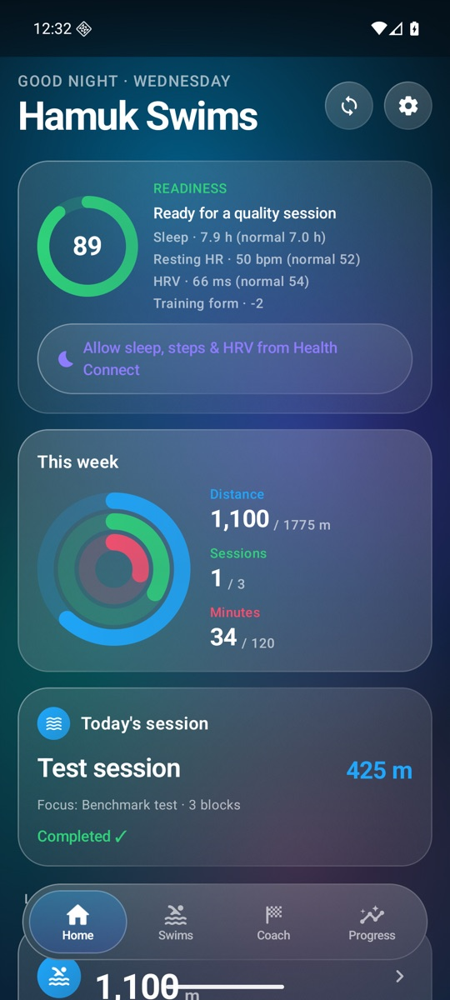

**Home** answers "how am I today, and what's next?":

- **Readiness (0–100):** last night's sleep, morning resting HR and HRV vs *your* normal, plus training form. Under 45, today's planned session switches to easy work.
- **This week rings:** distance, sessions and minutes vs plan.
- **Today's session:** tap to see the full workout with target paces.
- **Goal navigator:** on track or behind, and the pace for your next main set.
- **Since your last swim:** the biggest changes vs your previous swim.

After each swim, open it and set **How did it feel? (RPE 1–10)**. It takes two seconds and makes fatigue detection and the lifestyle analysis much better.

 

## 6. Reading a swim

Open any swim. It has three tabs:

| Tab | What you get |
|---|---|
| **Overview** | Distance, time, pace, HR, calories, SWOLF; HR curve; pace per length; your RPE, notes and pool length. |
| **Analysis** | Insights; *Before this swim* (sleep, steps, recovery); load (sTSS, TRIMP), efficiency, aerobic drift, rest %; comparison with previous swim, previous day or 28-day normal; HR zones; HR vs pace per length; pacing (split, variation, fade); technique (SWOLF, stroke rate, distance per stroke). |
| **Lengths** | Every length with stroke, time and SWOLF. |

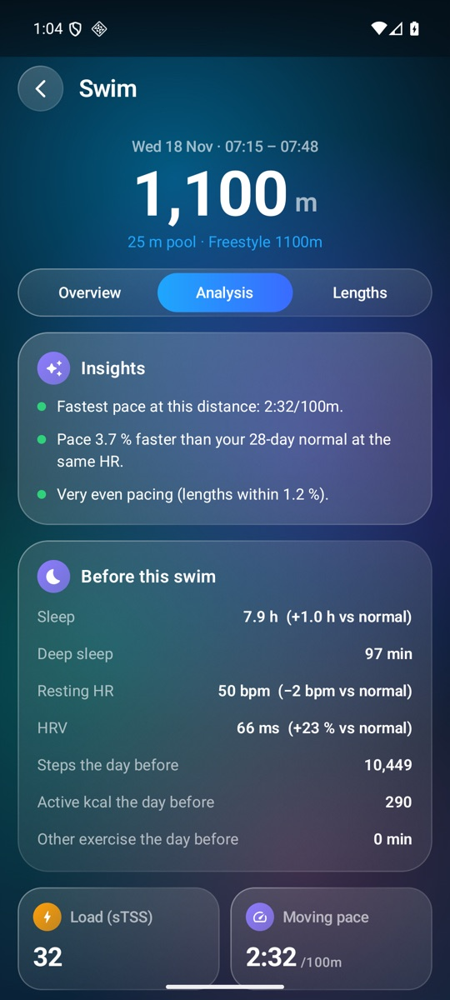
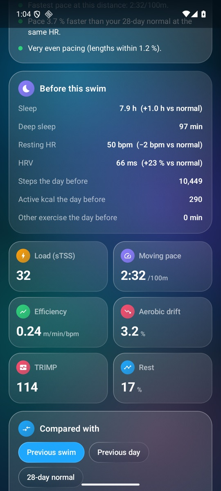
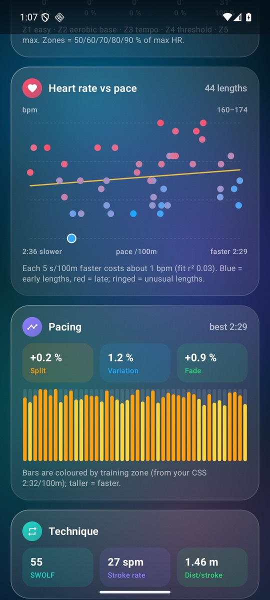
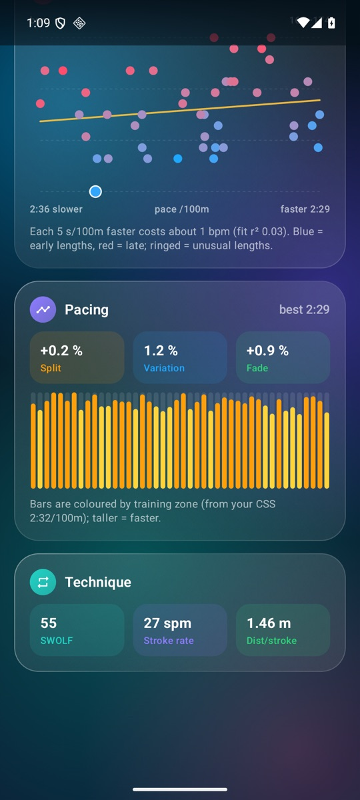

**Reading the arrows:** ▲ ▼ shows the direction of change; **green = better, red = worse**, grey = neither (e.g. heart rate on its own). Changes under 1 % count as noise.

**Compare anything:** tap *Open side-by-side* (or the Home card) to compare two **swims**, **days** or **weeks**, with overlaid pace and heart-rate curves.

Not sure what a metric means? See [METRICS.md](METRICS.md).

## 7. Goals, plans and the goal navigator

1. **Coach → Set a goal**, then pick one:
   - **Swim further:** e.g. 1,000 m without stopping.
   - **Swim faster:** e.g. 400 m in 8:30.
   - **Technique / new stroke:** e.g. breaststroke, bilateral breathing.
   - **Fitness:** a weekly minutes target.
2. Choose 4–26 weeks and tap **Build my plan**.

The plan uses your threshold pace (CSS) for zones, builds base → build → taper with a recovery week every 4th week, and adapts automatically:
- It **repeats a week** if you did fewer than half its sessions.
- It **adds a recovery week** if your average RPE was 8.5 or higher.
- It **schedules a retest** if you're consistently faster than your zones.

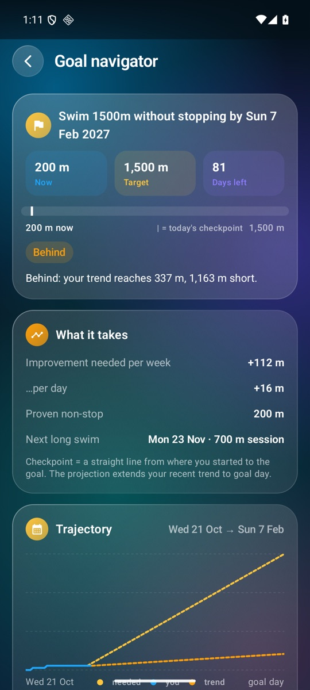

**Goal navigator** (Coach or Home → *Goal navigator*) works fully offline:
- **Now vs target** and today's **checkpoint** on a straight line from start to goal.
- **What it takes:** improvement needed per week and per day; for time goals, race pace and the threshold pace needed.
- **Trajectory:** needed line vs your actual progress and trend projection.
- **Volume:** metres left to goal day, per day and per session.
- **Next 7 days:** each planned swim with **exact target paces** (warm-up, main set, goal pace) and an **HR ceiling** for easy sets.

 

## 8. Tests: keeping your paces accurate

Every pace target comes from your **threshold pace (CSS)**. Without a test, the app estimates it from your recent swims; a test makes it accurate.

- **Beginner benchmark** (can't yet swim 400 m non-stop): after a warm-up, swim 100 m fast with good form, rest 3–5 min, then swim steadily as far as you can.
- **CSS test** (400 m non-stop is OK): after a warm-up, swim 400 m at your best even pace, recover 5–8 min, then swim 200 m all-out.

Log results in **Coach → Log test**. All zones and future workouts update instantly. Retest every ~5 weeks (the plan schedules it).

## 9. Progress and "what affects your swimming"

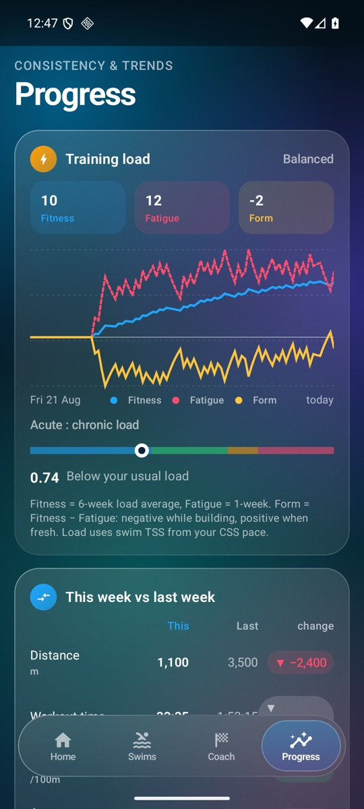
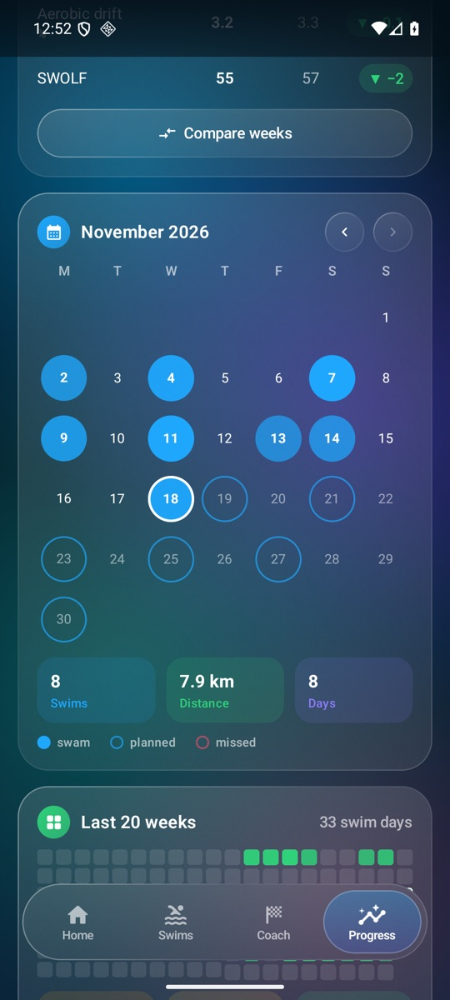
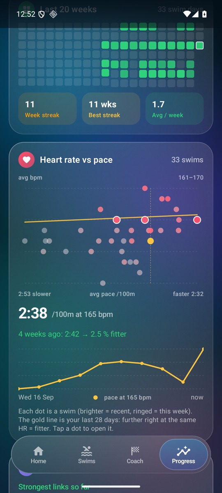
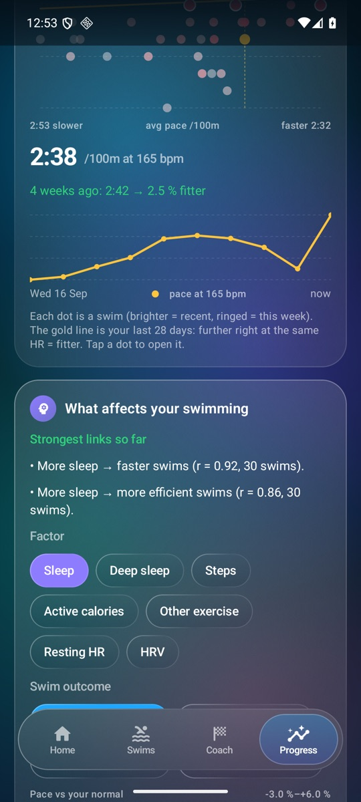

- **Training load:**
  - **Fitness** is what you're used to (6-week average load).
  - **Fatigue** is the last week's load.
  - **Form** = Fitness − Fatigue. Between −10 and −30 is normal while building; above +15 means fresh.
  - The **acute:chronic gauge** warns when you ramp up too fast. Ignore it in your first ~4 weeks of data: with little history it overreacts.
- **Calendar & heatmap:** swim days light up (brighter = longer). Rings mark planned sessions, red rings missed ones.
- **Heart rate vs pace:** your **pace at your usual heart rate** is the cleanest fitness signal. If it gets faster over the weeks, you're getting fitter.
- **What affects your swimming:**
  1. Pick a factor (sleep, deep sleep, steps, active calories, other exercise, resting HR, HRV) and an outcome (pace, efficiency, HR at the same pace, RPE).
  2. The card shows the scatter, low/mid/high comparison and a verdict.
  3. It only claims a link with 8+ swims and a meaningful correlation. Correlation isn't proof, but it's a strong hint.
- **Metric explorer & records:** chart any metric against your normal range; tap a point to open that swim.

## 10. The optional AI coach

1. Get a free API key at **aistudio.google.com → Get API key**.
2. **Settings → Coach chat · Gemini → Paste key → Save key.** The model stays on **auto**, which picks the newest Flash model your key can use.
3. Open **Coach → chat**. Ask questions, or tap **Review my last swim**. The coach sees your analysis, readiness and goal status.
4. It can **propose** plan changes, e.g. a new goal, fewer sessions, a swapped workout or a recovery week. Nothing changes until you tap **Apply**.

**Usage & limits:** *Settings → Gemini usage* shows requests and tokens per day and alerts you at 80 % and 100 % of the daily allowance you set. Free keys are never charged; Google just pauses requests until the quota resets. You only pay if you enable billing on the key's Google Cloud project.

Everything except the chat works without a key.

## 11. Settings, data and privacy

- **Samsung Health / Data sources:** permission status and which apps provide what.
- **Sync now** · **Swimmer profile** (level, schedule, pool, age, max/resting HR overrides).
- **Data inspector:** the raw data Health Connect returns for your recent swims. Useful to check which watch metrics come through.
- **Export CSV / JSON backup** of your swims, profile, goal and tests.
- **Privacy:** data never leaves your phone except the chat summary sent to Gemini when you use it.

## 12. Troubleshooting

| Problem | Fix |
|---|---|
| No swims appear | Check Samsung Health → Settings → Health Connect sharing is on, then Hamuk Swims → Settings → *Review access*. Pull down on Swims. |
| Only the last month imported | Turn on **Access past data** for Hamuk Swims in Health Connect. |
| No SWOLF / stroke rate | Your watch app may not export stroke counts to Health Connect. Check *Data inspector*. You can type SWOLF on the swim. |
| Paces feel too easy or too hard | Log a test (§8). Without one, CSS is estimated. |
| Readiness is empty | Allow Sleep / Resting HR / HRV in Health Connect (button on the Readiness card) and wear the watch overnight. |
| "Load spike: injury risk" right after you start | Normal with little history. It settles after ~4 weeks of regular data. |
| Chat error | Check the key, or wait if you hit the free quota (see *Gemini usage*). The rest of the app keeps working. |
